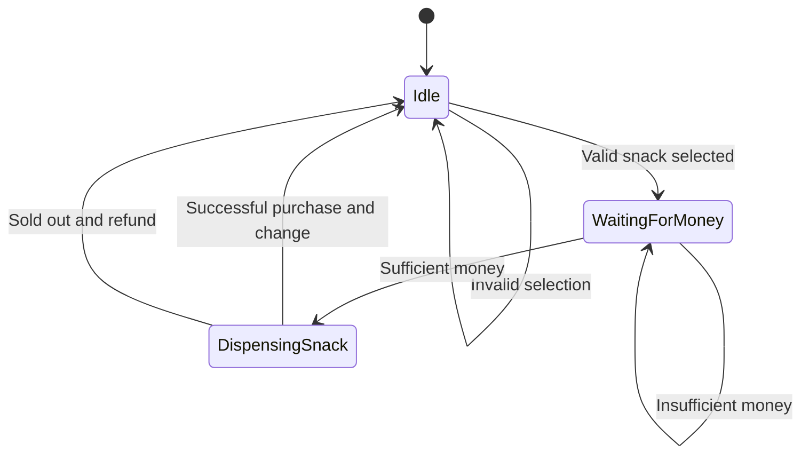

# Homework 11 - Behavioral Design Patterns

## Vending Machine

This project implements a vending machine using the State
and Chain of Responsibility design patterns.

## State Design Pattern

The vending machine changes its behavior depending on
its current state:

- Idle
- Waiting for Money
- Dispensing Snack

Each state implements the StateOfVendingMachine interface.

## Chain of Responsibility Design Pattern

Snack requests are passed through a chain of handlers
until the correct snack is found.

Handler order:

Coke -> Pepsi -> Cheetos -> Doritos -> KitKat -> Snickers

## State Transition Diagram

## Snack Inventory

| Snack | Price | Initial Quantity |
|---|---|---|
| Coke | $1.50 | 5 |
| Pepsi | $1.50 | 5 |
| Cheetos | $2.00 | 5 |
| Doritos | $2.00 | 5 |
| KitKat | $1.75 | 5 |
| Snickers | $1.75 | 1 |

## Source Code

- Snack.java
- SnackDispenseHandler.java
- StateOfVendingMachine.java
- IdleState.java
- WaitingForMoneyState.java
- DispensingSnackState.java
- VendingMachine.java
- VendingMachineDriver.java

## Unit Tests

- SnackTest.java: 7 tests
- SnackDispenseHandlerTest.java: 7 tests
- VendingMachineTest.java: 14 tests

Total: 28 unit tests.

The tests verify inventory management, state transitions,
payment handling, change, and refunds.

## Driver Output

The driver demonstrates successful purchases, insufficient
payments, multiple payments, returning change, invalid
selections, and sold-out snacks.

Snickers reaches a quantity of zero after the first
purchase. The next attempt to purchase Snickers results
in a full refund.

## How to Run

Run VendingMachineDriver.java in IntelliJ IDEA.

To run all unit tests, open Maven, expand Lifecycle,
and select test.

## Reflection

I think this assignment helped me better understand how
multiple design patterns can work together in one program.
The State pattern made it easier to separate the different
behaviors of the vending machine, while the Chain of
Responsibility pattern made handling snack requests more
organized. The unit tests were also helpful in making sure
the machine handled payments and refunds correctly,
especially when Snickers ran out. Overall, I think using
these patterns made the program easier to understand,
maintain, and expand.